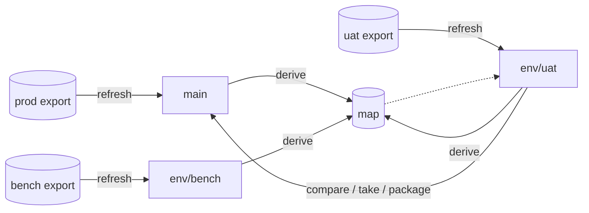

# Concepts

| Word | What it is |
|---|---|
| **Chain repository** | A git repository with the folders and jobs of one Control-M application, as JSON: one file per folder, one per job. |
| **Environment** | One Control-M environment (production, UAT...). Each has a letter that its names carry. |
| **Branch of an environment** | `main` is production; `env/<name>` every other one. A branch is what the last full export of its environment said. |
| **Letter rule** | Names are stored without the environment's letter: `UP77_LOAD` in UAT and `PP77_LOAD` in production are both `P77_LOAD` in the repository. The export puts the letter back. |
| **Map** | What is expected to differ between environments besides the letter: a machine, a user, the datacenter, a word in a mail subject. One entry per value, with what each environment has. It lives on its own branch, `map`. |
| **Link** | A condition, as a first-class thing: who emits it, who waits for it, who deletes it. |
| **Item** | Something that can travel: an attribute, a variable, a job, a folder, a sub-application, a condition name. Written `attr:F/J@NAME`, `var:F/J@%%NAME`, `job:F/J`, `folder:F`, `subapp:S`, `link:ID`. |
| **Delivery** | Items kept under a name, to make an import file later. |

## How it fits together



- **An export comes in through `refresh`**, and replaces the branch of its environment.
  Production is never edited in the repository: its branch changes only when its next
  export arrives.
- **Two environments are compared through the map.** The branch of one is read in the terms
  of the other: its letter, its machines, its users. What still differs is a real
  difference.
- **What travels is an item.** `take` brings it into the branch that is checked out;
  `package` writes the import file of the environment that receives it; a *delivery* keeps
  it for later.
- **Control-M imports whole folders.** An import file holds each folder it touches whole:
  the folder as the receiving environment has it, with the chosen items on it.

## What is where

```text
chains/
  chain.json                      application, environments, letter rule
  envs/<env>/env.json             the letter and the display name of an environment
  folders/<FOLDER>/folder.json    the folder
  folders/<FOLDER>/jobs/<JOB>.json
  folders/<FOLDER>/links.json     the names of its conditions
  meta/                           what makes the export byte for byte the one that came in
```

The map and the deliveries are not in these files: they are on the branch `map`.
