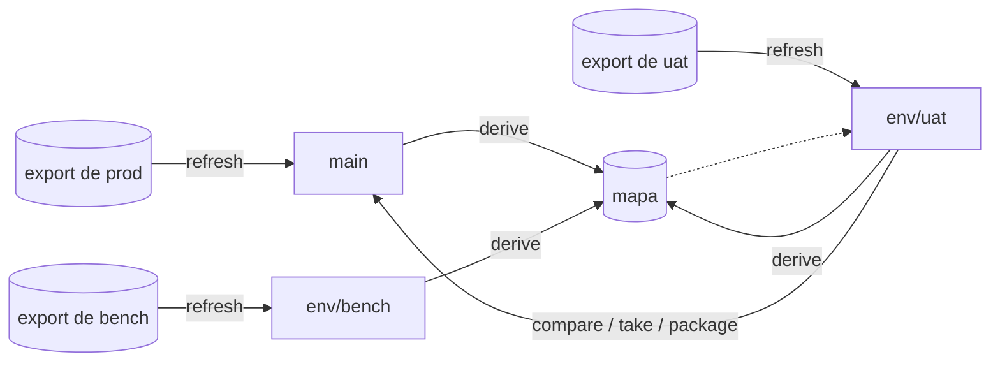

# Conceitos

| Palavra | O que é |
|---|---|
| **Repositório de cadeias** | Um repositório git com as pastas e os jobs de uma aplicação Control-M, em JSON: um ficheiro por pasta, um por job. |
| **Ambiente** | Um ambiente Control-M (produção, UAT...). Cada um tem uma letra que os seus nomes levam. |
| **Branch de um ambiente** | `main` é a produção; `env/<nome>` cada um dos outros. Um branch é o que o último export completo do ambiente disse. |
| **Regra da letra** | Os nomes guardam-se sem a letra do ambiente: `UP77_LOAD` em UAT e `PP77_LOAD` em produção são ambos `P77_LOAD` no repositório. O export volta a pôr a letra. |
| **Mapa** | O que se espera que difira entre ambientes além da letra: uma máquina, um utilizador, o datacenter, uma palavra no assunto de um e-mail. Um item por valor, com o que cada ambiente tem. Vive num branch próprio, `map`. |
| **Ligação** | Uma condição, como coisa de primeira classe: quem a emite, quem espera por ela, quem a apaga. |
| **Item** | O que pode viajar: um atributo, uma variável, um job, uma pasta, uma sub-aplicação, o nome de uma condição. Escreve-se `attr:F/J@NOME`, `var:F/J@%%NOME`, `job:F/J`, `folder:F`, `subapp:S`, `link:ID`. |
| **Entrega** | Itens guardados com um nome, para gerar um ficheiro de import mais tarde. |

## Como encaixa



- **Um export entra pelo `refresh`** e substitui o branch do seu ambiente. A produção nunca
  se edita no repositório: o branch dela só muda quando chega o export seguinte.
- **Dois ambientes comparam-se através do mapa.** O branch de um é lido nos termos do
  outro: a letra, as máquinas, os utilizadores. O que ainda difere é uma diferença real.
- **O que viaja é um item.** O `take` trá-lo para o branch que está aberto; o `package`
  escreve o ficheiro de import do ambiente que recebe; uma *entrega* guarda-o para depois.
- **O Control-M importa pastas inteiras.** Um ficheiro de import traz inteira cada pasta em
  que toca: a pasta tal como o ambiente que recebe a tem, com os itens escolhidos por cima.

## O que está onde

```text
chains/
  chain.json                      aplicação, ambientes, regra da letra
  envs/<env>/env.json             a letra e o nome de um ambiente
  folders/<PASTA>/folder.json     a pasta
  folders/<PASTA>/jobs/<JOB>.json
  folders/<PASTA>/links.json      os nomes das suas condições
  meta/                           o que faz o export sair byte a byte como entrou
```

O mapa e as entregas não estão nestes ficheiros: estão no branch `map`.
